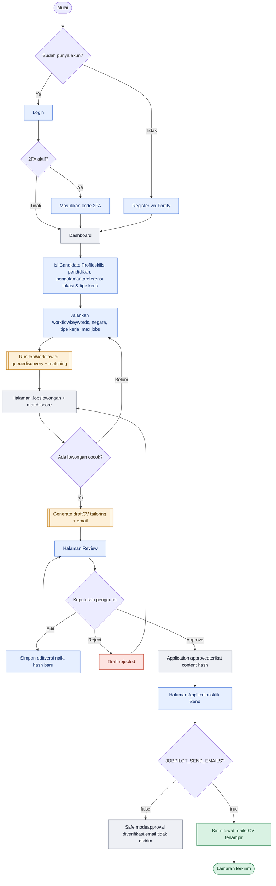
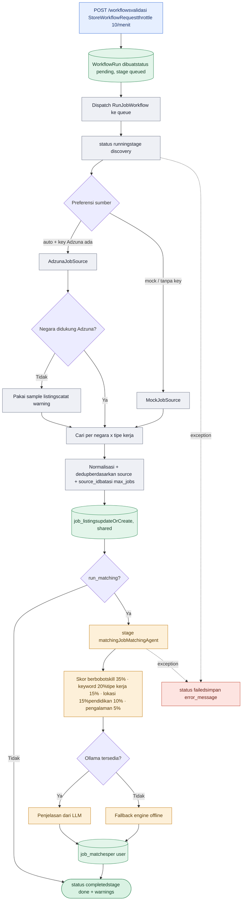
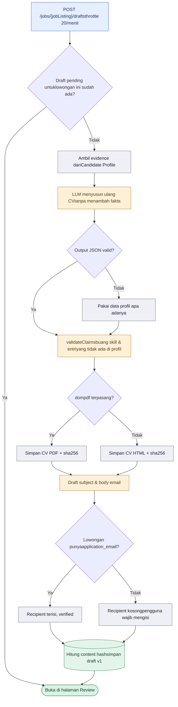
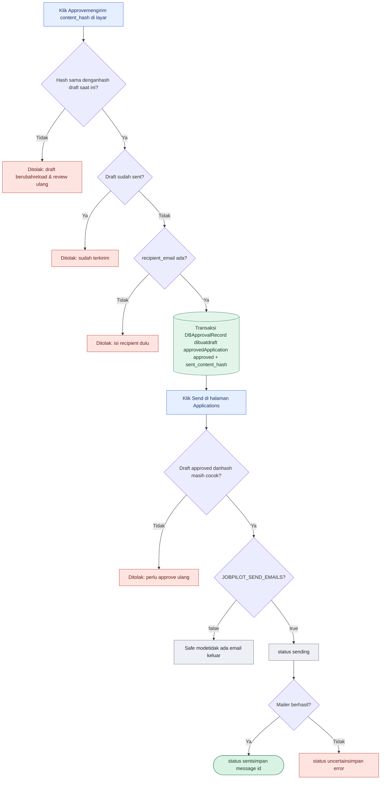
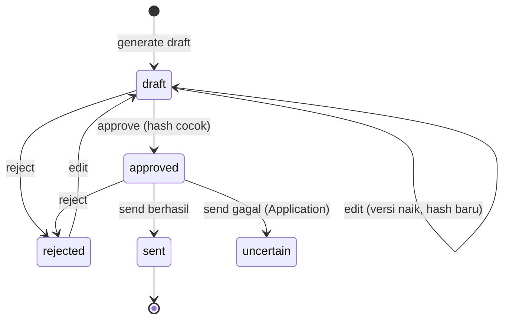

Joob-seeker · Laravel 13 + Inertia + React

# Flowchart JobPilot AI

Alur sistem JobPilot dari registrasi sampai lamaran terkirim: pencarian lowongan di background, skor kecocokan, CV yang disesuaikan, dan gerbang persetujuan berbasis content hash. Setiap diagram punya tombol untuk menyalin kode Mermaid-nya.

Aksi pengguna Proses sistem Agent AI / LLM Database Ditolak / gagal Selesai

[1. Alur utama](#utama) [2. Discovery & matching](#workflow) [3. Generate draft](#draft) [4. Approve & send](#approval) [5. Status draft](#status)

## 01Alur utama pengguna

Gambaran end-to-end: akun dibuat lewat Fortify, pengguna mengisi profil kandidat, menjalankan workflow pencarian, lalu memilih lowongan untuk dibuatkan draft lamaran yang wajib direview sebelum dikirim.

`routes/web.php``CreateNewUser``pages/*`

## 02Workflow discovery & matching

Berjalan sebagai queue job, jadi queue worker harus hidup. Lowongan disimpan bersama untuk semua user, sedangkan hasil matching milik masing-masing user. Skor deterministik adalah acuan utama; analisis LLM hanya pelengkap.

`WorkflowController``RunJobWorkflow``JobDiscoveryAgent``JobMatchingAgent`

## 03Generate draft lamaran

CV hanya boleh diurutkan ulang dan disesuaikan bahasanya. Setiap skill atau entri yang tidak ada di profil dibuang oleh validateClaims. Alamat penerima hanya diambil dari email yang tercantum di lowongan, tidak pernah ditebak.

`ApplicationDraftController@store``CvTailoringAgent``EmailApplicationAgent`

## 04Approve & send

Gerbang keamanan inti. Approval mengikat hash dari recipient, subject, body, dan CV yang persis dilihat pengguna. Saat Send, hash dihitung ulang; kalau ada perubahan sejak approval, pengiriman ditolak.

`ApplicationDraftController@approve``ApplicationController@send``ApplicationDispatcher`

## 05Siklus status draft

Draft yang sudah approved atau sent tidak bisa diedit. Draft yang ditolak masih bisa diedit dan kembali ke status draft dengan versi baru.

`ApplicationDraft``Application`

Disusun dari kode di folder Joob-seeker (routes, controllers, services JobPilot, dan RunJobWorkflow) per 20 Oktober 2026.